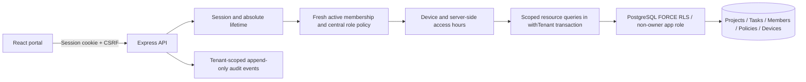

# WorkSphere

Security extension: see [SECURITY_EXTENSION.md](SECURITY_EXTENSION.md) for Content Library, tenant API keys, encryption/rotation, quotas, Data Explorer, database hardening and existing-database upgrade steps.

A tenant-safe workspace portal for Syntax Syndicate / Advantix Hackathon. React + TypeScript frontend, Express API, PostgreSQL with forced Row-Level Security (RLS). See [APPLICATION_GUIDE.md](APPLICATION_GUIDE.md) for the full user walkthrough and [VERIFICATION.md](VERIFICATION.md) for actual verification results and remaining gaps.

A **tenant** is one company’s workspace. Acme and Globex share the application and database, but each company should see only its own projects, tasks, members, devices and audit records. A forgotten company filter can otherwise expose another company’s data.

## Quick start: Docker (persistent data, PostgreSQL 16)

Install Docker Desktop with Linux containers and Docker Compose v2. From this repository:

```sh
docker compose up --build
```

Open **http://localhost:5173**. API: **http://localhost:3000/api/health**. The database becomes healthy first; the API then migrates and seeds before starting. First build needs internet. The supplied Compose defaults are explicitly for a local demo, bound to localhost. No `.env` is required for this path. Do not expose these defaults on a public server.

```sh
docker compose logs -f api
docker compose down
```

`down` preserves the `pgdata` volume. Starting again preserves accounts, authenticator secrets, policies and project data. `docker compose down --volumes` permanently deletes this demo database; use it only when you intend a full reset. Role initialization runs only for a new volume. Changing database password variables does not change an existing database password.

## Quick start: without Docker (temporary data)

Requires Node.js **22 LTS** and npm. Node 20.19+ also worked during local checks. The optional embedded PostgreSQL package includes native binaries for supported platforms.

```sh
npm ci
npm run local
```

Open **http://localhost:5173**. This command creates a temporary database on port **55432**, migrates, seeds, and launches the API on **3000** and Vite on **5173**. Stop with **Ctrl+C**. **This mode deletes its database on exit**; it is intended for demonstration and verification. Use Docker for saved work. Do not run two local runners at once. Windows may require permission for PostgreSQL executables or firewall access on localhost.

## First sign-in and demo accounts

All seeded accounts use `Demo-WorkSphere-2026!` unless `SEED_PASSWORD` was set before their creation.

| Email                 | Workspace         | Role   |
| --------------------- | ----------------- | ------ |
| alice@worksphere.test | Acme Corp / Alpha | Admin  |
| bob@worksphere.test   | Acme Corp / Alpha | Member |
| carol@worksphere.test | Acme Corp / Alpha | Viewer |
| dave@worksphere.test  | Globex Ltd / Beta | Admin  |
| erin@worksphere.test  | Globex Ltd / Beta | Member |
| sam@worksphere.test   | Both              | Member |

1. For the easiest unrestricted tour, use **Dave** and Globex.
2. Expand **Local demo tools** on the login screen and click **Get current demo code**. This calls the development-only code helper. The seed no longer prints passwords or authenticator secrets.
3. Enter email, password and the current six-digit code; click **Sign in**.
4. Select your workspace.
5. For Alice, first click **Bootstrap Alice’s device** on the local login screen. The seed approves the matching local demo token only for Alice in Acme. Acme still enforces **Monday–Friday, 09:00–18:00 Asia/Kolkata**. Globex allows all days and does not require device approval.
6. A TOTP code works **once**. After sign-in, wait for the next 30-second code before using step-up. Three failed logins lock the account for 15 minutes.

The code helper and bootstrap are deliberate local demo conveniences. `DEV_ONLY=true` is rejected with `NODE_ENV=production`; never seed demo users or device tokens into a production database.

## Development with your own PostgreSQL 16

Create an empty `worksphere` database owned by a login role `worksphere_owner` (NOSUPERUSER, NOBYPASSRLS). Create `worksphere_app` as a separate login, also NOSUPERUSER and NOBYPASSRLS. Give the owner ownership of the public schema. `scripts/init-db.sh` is an example bootstrap for a fresh database using an initial privileged bootstrap administrator.

PowerShell:

```powershell
Copy-Item .env.example .env
npm ci
```

Edit `.env` so both database URLs match those roles. Generate secrets:

```sh
node -e "console.log(require('crypto').randomBytes(32).toString('hex'))"
```

Run that twice: use one value for `SESSION_SECRET`, the other for `TOTP_ENCRYPTION_KEY` (exactly 64 hex characters). Then:

```sh
npm run migrate
npm run seed
npm run dev
```

The web proxy defaults to `http://localhost:3000`; Compose overrides it to `http://api:3000`. Keep the hostname `localhost` consistent in the browser, WEB_ORIGIN and requests. Don’t switch to `127.0.0.1` midway through a session.

| Variable            | Purpose                                                                            |
| ------------------- | ---------------------------------------------------------------------------------- |
| DATABASE_URL        | API login as worksphere_app                                                        |
| OWNER_DATABASE_URL  | Schema and seed login as worksphere_owner; keep out of deployed API runtime        |
| POSTGRES_PASSWORD   | Local Compose owner/bootstrap password                                             |
| APP_DB_PASSWORD     | Local Compose API database password                                                |
| SESSION_SECRET      | At least 32 random characters                                                      |
| TOTP_ENCRYPTION_KEY | AES-256 key: 64 hex characters; changing it invalidates existing encrypted secrets |
| WEB_ORIGIN          | Exact trusted browser origin, default http://localhost:5173                        |
| PORT                | API port, default 3000                                                             |
| NODE_ENV            | development, test or production                                                    |
| DEV_ONLY            | Enable local TOTP helper only outside production                                   |
| SEED_PASSWORD       | Initial password of newly created demo accounts                                    |
| API_PROXY           | Vite backend target; optional local/Docker override                                |
| API_URL             | Optional HTTP target for the demo script                                           |

## Commands and testing

Use a **disposable seeded database**, never a live production database: API tests temporarily change policies, authentication counters and memberships.

```sh
npm run lint
npm run typecheck
npm run build
npm run test:local
```

`test:local` creates, tests and removes its own real PostgreSQL database. To use an existing disposable database configured in `.env`:

```sh
npm run migrate
npm run seed
npm test
npm run test:db
npm run test:attacks
```

`npm test` is one command for unit, DB and API attack checks with a real database already running. It does not silently skip database tests if PostgreSQL is unavailable. Coverage is written to `coverage/`; open `coverage/index.html`. The Playwright browser test is separate:

```sh
npx playwright install chromium
npm run test:browser
# Or, against a running disposable app configured in .env:
npm run test:e2e
```

`test:browser` starts and stops a temporary app and database automatically. For `test:e2e`, keep a fresh local demo/Compose application running. It uses Dave and Carol and changes a seeded task. Current TOTP reuse or a locked account can cause an intentional rejection; wait for a new code/reset the disposable database. `npm run demo` runs an HTTP demo against the running development server, using Alice and Carol; it requires Acme access hours/device setup. It demonstrates task completion, cross-tenant 404, Inspector and viewer write denial. It is not a claim to reproduce every requested presentation step automatically.

CI runs lint, typecheck, production builds, unit/API/DB tests against PostgreSQL 16, a browser demo, coverage upload, and Gitleaks. CI status must be observed on GitHub; no green CI result is claimed here.

## Architecture and isolation layers



- Tenant identity comes from the server-side session, never an arbitrary request header. Workspace selection checks current active membership. Tenant requests reload membership and role.
- Central `policy/permissions.ts`: Admin manages work and security; Member edits work; Viewer reads work.
- `withTenant` sets `app.tenant_id` **transaction-locally** on a checked-out pooled connection, then commits/rolls back and releases it. No context means no tenant rows. RLS uses `nullif` to handle PostgreSQL’s empty reset setting safely.
- Both owner and API roles are non-superuser/non-BYPASSRLS. Tenant tables use ENABLE + FORCE RLS. A narrow SECURITY DEFINER function discovers active memberships before selection by iterating authorized tenant contexts; it restores context before returning. The function is accessible only to the server database role.
- Cross-tenant resources and nonexistent IDs produce the same `404` error text. Invalid UUIDs produce `400`. This does not establish constant-time behavior.
- Composite tenant/project foreign keys block cross-company task links. Service checks validate active same-tenant assignees.
- Argon2 passwords; AES-256-GCM encrypted TOTP secrets; ±1-step drift and atomic replay-counter update. Login rotates session IDs. Lockout follows three failures.
- Sessions: PostgreSQL store, 30-minute rolling idle timeout, 8-hour absolute lifetime, HttpOnly/SameSite=Lax; Secure cookies in production. Development uses HTTP cookies on localhost.
- Mutations require exact Origin and session-bound CSRF headers, including login. Helmet, bounded JSON payloads, parameterized SQL, IP and authenticated-user rate limits apply.
- App role can select/append audit events but cannot update/delete them. Inspector is Admin-only and tenant-scoped. Runtime errors log only request IDs and status, not request bodies or credentials. Seed output does not print passwords or authenticator secrets.

## Demo sequence

1. Alice logs in with the bootstrap device during Acme hours, opens Alpha, selects Product launch, changes a task to Done.
2. Run `npm run demo` with a fresh code window to issue a known Globex project request and show the uniform 404. In Inspector filter outcome `denied`; the event includes only the attempted UUID and caller’s tenant.
3. Dave can sign into Beta to confirm its projects are unchanged. Carol can read Alpha but API writes receive 403.
4. On a disposable account, enter a wrong code three times. Inspector shows `auth.lockout` for that account’s active memberships.
5. In Settings, use a fresh code to verify; create a 30-minute override for Alice **before** excluding the current time. Save the policy, then observe out-of-hours denial for other users and override redemption for Alice.
6. Run `npm run test:local` or CI for automated isolation evidence. `npm run proof:rls` (configured disposable database) demonstrates that removing projects RLS exposes rows and rolls the change back. Never use a production database for proof scripts.

Known IDs: tenants `10000000-0000-4000-8000-000000000001` (Acme), `…0002` (Globex); projects `30000000-0000-4000-8000-000000000001/2` (Acme), `…0003/4` (Globex). User IDs `20000000-0000-4000-8000-000000000001` through `…0006` follow the account table order.

## Troubleshooting and recovery

- **Login failed:** use the correct password and a new code. Previously used codes and locked accounts intentionally have the same message. Wait 15 minutes after lockout.
- **Device approval required:** sign in once to create a pending row; an approved Admin opens Settings and approves it. Alice’s local bootstrap solves only the fresh demo’s first Admin device problem.
- **Outside workspace access hours:** use Globex to tour immediately, wait for Acme’s window, or pre-create an override while an administrator is allowed in. The application does not let a locked-out Admin bypass its own policy.
- **All Acme Admins locked out:** the database operator must perform a documented, exceptional recovery. For a local Compose demo only, run the following owner query; it deliberately opens Acme all day and relaxes its device policy. Restore the required settings afterward. This is operator access, not an application bypass.

```sh
docker compose exec postgres psql -U worksphere_owner -d worksphere -c "BEGIN; SELECT set_config('app.tenant_id','10000000-0000-4000-8000-000000000001',true); UPDATE tenant_policies SET access_days=ARRAY[0,1,2,3,4,5,6],access_start='00:00',access_end='23:59:59',require_trusted_device=false; COMMIT;"
```

- **Fresh verification changed policies:** tests restore Acme’s strict policy; use a separate disposable database for tests.
- **Invalid Origin / CSRF:** use localhost:5173, fetch `/api/auth/csrf`, retain cookies, and supply the returned token as `X-CSRF-Token` with the exact Origin on mutations. Login returns a new token.
- **Address in use:** stop the other API/web/local database; ports are 3000, 5173, 5432 (Docker) or 55432 (temporary runner).
- **Existing volume/password mismatch:** use the original credentials or rotate them explicitly with your database administrator. Reseeding does not reset existing passwords or secrets.

## Threat model, limitations and production work

The main adversary is an authenticated user trying to cross company boundaries, spoof tenant context, exceed role permissions or replay credentials. RLS is a second boundary if a scoped query omits a filter. It is not a boundary against a compromised API process that possesses the database credential and can set arbitrary tenant context.

A stolen valid session or approved-device token, compromised user device, malicious database administrator, runtime compromise, timing/traffic side channels and insecure deployment remain material risks. This MVP has no production security audit. Results apply only to included tests. Do not call it unbreakable.

The Compose stack serves development Vite/HTTP and uses local demo defaults, enrollment output and a known bootstrap device. Production requires TLS/reverse proxy, narrowly configured trusted proxy handling for Secure cookies, dedicated runtime secrets, removal of seed/helper/bootstrap paths, separate migration credentials, shared rate-limit storage across replicas, monitoring, backups, key rotation and recovery procedures. Invite creates a **new** account only; it does not enroll an existing account into another company. There is no self-service registration/password reset/TOTP reset. Active-assignee validation is service-level and has a concurrency gap against simultaneous revocation. Audit writes are currently separate transactions from work mutations, so an audit-store failure may follow an already committed operation. See VERIFICATION.md for test coverage gaps and implementation deviations.

## Future scope

Enterprise SSO, project membership/permissions, email delivery, S3 signed URLs, chat and billing remain future scope. Tenant file encryption, scoped API keys and local encrypted file storage are now implemented; see SECURITY_EXTENSION.md.

## Repository map

- `apps/api/src/app.ts`: API routes, authentication and guards; centralized route registration.
- `apps/api/src/db/`: pool/context transaction helper, idempotent migration, seed.
- `apps/api/src/policy/permissions.ts`: single permission matrix.
- `apps/api/src/crypto.ts`: authenticated encryption and TOTP helpers.
- `apps/api/tests/`: unit, SQL-level and API attack verification.
- `apps/web/src/`: React portal, request helper, responsive Tailwind/CSS design.
- `scripts/`: temporary local runner, HTTP demo, Playwright test, RLS proof.
- `.github/workflows/ci.yml`: database-backed CI and secret scan.
