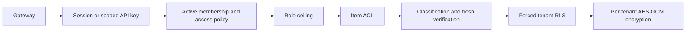

# WorkSphere security extension

The extension adds a Content Library, scoped API keys, a tenant Data Explorer, per-company file encryption and data limits. Existing projects, tasks, authentication and workspace policies remain in place.

## Start or upgrade

For a fresh temporary demo, run `npm ci` then `npm run local`. Open **http://localhost:5173**. Stop with Ctrl+C; the temporary database and uploaded files are deleted. Sign in as Dave (`dave@worksphere.test`, `Demo-WorkSphere-2026!`) using **Local demo tools → Get current demo code**, then select Globex.

For persistent storage, run `docker compose up --build`. PostgreSQL and encrypted content use separate named volumes. Preserve both volumes and the encryption keys together. `docker compose down` preserves them; deleting volumes destroys saved data.

**Existing Docker database:** the migration account intentionally cannot create database roles. Before updating an existing volume, run the bootstrap role hardening once:

```powershell
docker compose up -d postgres
docker compose exec postgres psql -U bootstrap_admin -d worksphere -f /security.sql
docker compose up --build
```

The new Compose mount makes `/security.sql` available. For your own PostgreSQL, run `db/security.sql` against the WorkSphere database as its bootstrap administrator, then `npm run migrate` as the owner. This creates the readonly group without giving the API permission to create roles. Run `npm run db:audit` using `DATABASE_URL` after migration. Do not reset a database volume to solve a role-upgrade problem.

## Try the new screens

1. **Content library:** enter a title, select File or Document, choose a classification (or the workspace default), and choose/drop one file. Click **Upload securely**. Files are limited to 10 MB; default tenant storage is 200 MB, including retained versions and soft-deleted files.
2. Select the item to see metadata, versions and permitted actions. Images and PDFs support an authenticated sandboxed preview; other types are download-only. Uploading a new version preserves history. Delete hides an item without reclaiming its retained storage.
3. **Share within this company:** choose User, Role or API key, enter the member/key UUID or role name, select a permission and optional expiry, and save. **Show access list** displays grants; **Remove grant** revokes one. Project grants fail closed because the base application has no project-membership model.
4. **API keys** (Admin): verify with a fresh code, choose scopes and expiry, and create a key. Copy it immediately; its full value cannot be retrieved later. Rotation gives the old key at most five more minutes. Revocation is immediate. Key IDs shown on this page can be used in content ACLs. Rotation creates a new principal: re-grant its content ACLs deliberately.
5. **Data Explorer** (Admin): select a dataset, filter, sort, hide columns and paginate. The banner identifies the current company. CSV export requires fresh verification, is limited to 1,000 rows, escapes formulas, excludes restricted content, and is audited. Content rows and counts also obey the item ACL and classification rules. There is no SQL console or tenant database login.
6. **Security settings:** after verification, edit allowed file types/kinds, default classification, storage quota and row limits. The storage panel counts all retained versions. These controls are also available below Data Explorer.
7. **Security Inspector:** use Content Activity or API Keys filters, classification and outcome filters. Recent alerts cover download/denial bursts, restricted access, key IP changes, key rate spikes, quota warnings and integrity failures. Alerts are rules over the last five minutes, not a claim of comprehensive anomaly detection.

## Permission rules

Tenant membership is checked before content permission. Inaccessible or deleted items return the same 404; a visible item's forbidden action returns 403. The SQL predicate used for item checks also filters list/search results before pagination.

| Actor   | Internal                                                           | Confidential                    | Restricted                                                              |
| ------- | ------------------------------------------------------------------ | ------------------------------- | ----------------------------------------------------------------------- |
| Admin   | Can manage tenant items                                            | Owner or explicit grant         | Explicit grant, including Admin/owner; fresh TOTP for download/share    |
| Member  | Owner rights within edit/share ceiling; others need grants to read | Owner or explicit read grant    | Explicit grant; owner edit/share ceiling; fresh TOTP for download/share |
| Viewer  | Explicit view/download grants                                      | Explicit view/download grants   | Explicit view/download grants plus fresh TOTP to download               |
| API key | Matching content scope and explicit service-principal ACL          | Matching scope and explicit ACL | Always denied                                                           |

Member roles cannot manage/delete items or edit another person's items even if an ACL asks for more. Owners receive an explicit grant at creation for restricted items. Pending and quarantined content cannot be downloaded or previewed. Changing classification to restricted may remove your own access unless an explicit grant already exists; grant access before changing it.



## API keys and application secrets

Keys use `ws_live_` plus a random public prefix and a 32-byte random secret. Only an HMAC-SHA256 digest is stored. Supply credentials solely in `Authorization: Bearer …`; credentials in query parameters or JSON bodies are rejected. Keys cannot access membership, policies, devices, the explorer or key administration. They inherit a Member ceiling, further narrowed by the creator's current membership/role, scopes and item ACLs. Working-hour and trusted-device policies still apply; a service key does not supply a trusted browser device.

For production configure independent **FILE_KEK** (64 hex characters) and **API_KEY_PEPPER** (at least 32 random characters), in addition to SESSION_SECRET and TOTP_ENCRYPTION_KEY. Keep them outside the repository and database. Changing the pepper invalidates existing API keys. Development falls back to the existing TOTP key/session secret; Compose has explicit public demo defaults. These defaults are not production credentials.

Each tenant's random DEK is wrapped by FILE_KEK. Files use AES-256-GCM with a fresh 96-bit nonce and tenant ID as authenticated additional data. Downloads authenticate ciphertext and compare the plaintext SHA-256 before streaming. Storage keys are server-generated; metadata/explorer responses omit paths, DEKs, session data, password/TOTP material and key hashes.

**Rotate encryption:** verify, click **Rotate tenant encryption key**, then **Check rotation status**. The API persists a queued job; the server worker processes pending jobs every ten seconds, records progress and uses copy-on-write files plus a transaction to replace the DEK. After restart it retries queued/running jobs. Uploads and rotation share a tenant lock; downloads use a shared lock. Failed rotations retain the old committed keys/files and report failed status.

**Rotate the KEK:** configure the new FILE_KEK and temporarily set FILE_KEK_PREVIOUS to the old value. Restart, rotate every tenant, confirm completion/readability, then remove the previous key. `key_version` counts file-DEK generations; this implementation supports one previous KEK during transition, not an arbitrary secrets-manager keyring.

## Database security

`worksphere_owner` runs migrations; `worksphere_app` owns no tables, cannot create schema objects, and has no superuser, role-creation or RLS bypass privileges. Tenant tables force RLS and reject tenant-ID changes. Composite foreign keys and a principal-validation trigger block cross-tenant content references. Quotas serialize tenant writes; the application has bounded lists, upload limits and per-key limits. Audit events are SELECT/INSERT only for the API.

`worksphere_readonly` is a NOLOGIN developer group. It can read only explicitly granted non-secret columns and security-invoker views. PostgreSQL requires underlying column grants for security-invoker views; it therefore also permits direct reads of those same safe columns. It has no secret-column grants. A trusted database operator can set a tenant context; this is not a credential to give customers. A PostgreSQL superuser bypasses RLS by design and must never be the API identity.

`db:audit` checks every base table with tenant_id, enabled/forced RLS, enabled immutability triggers, app role flags/ownership/inherited roles, PUBLIC grants, schema CREATE rights, readonly secret exposure and append-only audit grants. CI invokes it before tests. `db/security.sql` documents statement/idle/lock timeouts, connection limits, SCRAM, production hostssl/TLS rules and connection logging. Production connections should use TLS and a database host restricted to the API; never expose port 5432 publicly.

## Offboarding and backup restore

These are explicit **operator commands**, not tenant web endpoints. They require owner credentials. Do not run them merely to explore the UI.

Set an independent 64-hex-character `OFFBOARD_EXPORT_KEY`, preserve it securely, then:

```powershell
npm run tenant:offboard -- TENANT_UUID backup.ws-export --confirm-delete
```

The command locks the affected tables during the export/delete transaction, writes and verifies a separately encrypted archive without overwriting existing files, deletes the live tenant rows/DEK/sessions, and removes its encrypted file versions. Shared user identities remain. Existing backup copies or previously copied keys are outside live crypto-shredding; apply a separate retention/destruction policy.

Restore on the same identity installation, or after restoring the shared user directory from its own encrypted backup:

```powershell
npm run tenant:restore -- TENANT_UUID backup.ws-export --confirm-restore
```

Restore requires an absent tenant ID and unused slug, verifies archive/file integrity, enforces the archived tenant ID, and creates a new DEK. It restores work, membership, policy, content and audit data. Old API keys, device trust and access overrides are invalidated and must be issued again. It does not overwrite a live company or recreate user passwords/TOTP secrets. The offboarding test creates a disposable tenant, exports it, proves its live DEK is unavailable, restores the archive and verifies file readability under a new key. Use the same procedure on a staging installation to test operational backups; the unit/integration test does not prove your deployment's backups work.

## Verification and limits

Run `npm run lint`, `npm run typecheck`, `npm run build`, `npm run test:local`, and `npm run test:browser`. Tests use a disposable database on port 56543; browser verification uses ports 5174 and 3001 to avoid the normal demo. Override LOCAL_DB_PORT, LOCAL_WEB_PORT and LOCAL_API_PORT if occupied. `test:local` includes db:audit and the RLS rollback proof. The Playwright flow covers Alice sharing confidential content with Bob and Carol, Carol's read-only controls, Dave's uniform 404, Inspector events and the Explorer. See VERIFICATION.md for the latest observed results; local results are not GitHub CI status.

Antivirus is not installed: clean means allow-listed signature/text validation succeeded. Text validation is UTF-8/control-character validation; it cannot establish the intent of arbitrary text. Office files are recognized by format signatures, not scanned for malicious document contents. Uploads and downloads buffer at most one allowed file for validation/integrity checks before streaming. There is no S3/MinIO or public/signed-link access. Optional custom-field definitions/values and personal-data tagging are not implemented; strict schemas reject arbitrary extra fields.

API key and upload rate counters are per process; use shared counters for replicas. Rotation jobs are durable but run in the API process, with transaction/tenant locks rather than an external worker queue. Crashes may leave unreferenced encrypted files requiring operator cleanup. File-system symlink checks cannot protect against a malicious local administrator racing path operations. Audit writes remain separate from work mutations, so an audit failure can follow a committed change. Preview rendering depends on the browser's image/PDF support.

A compromised API host/KEK, malicious database superuser, stolen valid session/API key until revoked, or malware on a user's device remains outside this boundary. TLS/reverse-proxy headers, encrypted full identity backups, backup retention, shared rate limiting, scanning and operational monitoring are deployment responsibilities. Future scope includes project membership/ACLs, S3/MinIO, SSO, customer-managed keys and more advanced anomaly detection. No production audit or claim of unbreakability is made.
